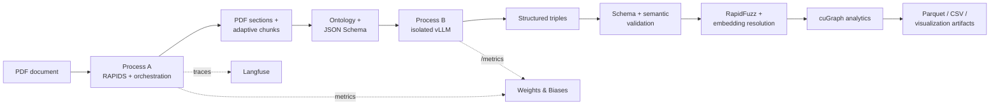

# GPU-Accelerated Knowledge Graph Pipeline

> A GPU-first document-intelligence system that converts unstructured PDF text into typed, validated, and analyzable knowledge graphs.

This repository contains the current GPU knowledge-graph project plus a preserved **v1 structured-extraction path** built around Qwen2.5-3B-Instruct-AWQ, isolated vLLM inference, RAPIDS, entity resolution, graph analytics, and observability. The v1 notebook and extracted source are kept intact so the implementation can be inspected and reproduced independently of newer development experiments.

## What the pipeline does



The validated v1 path deliberately separates Python environments: Process A runs RAPIDS and orchestration, while Process B runs vLLM behind a local HTTP endpoint. This prevents RAPIDS and vLLM CUDA/PyTorch/Numba dependency trees from being resolved in one interpreter while still allowing both processes to share a single GPU.

## v1 status and evidence

| Area | Status | Evidence |
|---|---|---|
| Notebook source | Preserved | [`notebooks/kg_pipeline_v1.ipynb`](notebooks/kg_pipeline_v1.ipynb) |
| Extracted pipeline source | Preserved and syntax-checked | [`kg_pipeline.py`](kg_pipeline.py) |
| vLLM isolation test | Preserved | [`scripts/test_vllm_server.py`](scripts/test_vllm_server.py) |
| RAPIDS import smoke test | Passed in supplied notebook run | cuDF, cuGraph, cuML, CuPy, Numba imported successfully |
| vLLM health/model checks | Passed in supplied notebook run | HTTP health check and model registration succeeded |
| Plain generation test | Passed in supplied notebook run | 9.1 seconds, 386 characters returned |
| JSON-schema generation test | Passed in supplied notebook run | 9.6 seconds, valid two-triple response |
| Full rerun on this checkout | Not claimed | Requires Linux, CUDA, RAPIDS, vLLM, model access, and credentials |
| Notebook v2 | Future work | Not represented as validated here |

The supplied run used a Tesla T4, CUDA 12.8 in PyTorch, RAPIDS 26.02 packages, Qwen2.5-3B-Instruct-AWQ, AWQ quantization, float16 inference, eager startup, and n-gram speculative decoding.

## Why the v1 path is more than an LLM demo

1. PDF text is segmented into layout-aware sections and bounded, overlapping chunks.
2. A domain classifier adds per-chunk domain context.
3. vLLM produces structured JSON constrained by an ontology-aware schema.
4. Pydantic and semantic rules reject malformed or incoherent triples.
5. RapidFuzz, canonical IDs, embeddings, and ANN search reconcile entity aliases.
6. cuGraph computes PageRank, in/out-degree, and Leiden communities.
7. Parquet/CSV graph artifacts, confidence, validation statistics, and runtime metrics are exported for inspection.

The graph is therefore accompanied by confidence, provenance, validation-drop counts, and operational telemetry rather than being treated as unqualified model output.

## Repository map

```text
.
├── kg_pipeline.py                  # v1 source extracted from notebook cell 15
├── scripts/test_vllm_server.py     # vLLM health, generation, and schema smoke test
├── scripts/validate_repo.py        # notebook/source parity and syntax checks
├── notebooks/kg_pipeline_v1.ipynb  # preserved executable v1 notebook
├── docs/
│   ├── architecture.md             # component and process-boundary explanation
│   ├── data-contract.md             # triple schema and validation gates
│   ├── profiling.md                 # Nsight provenance and analysis commands
│   └── pipeline-explorer.html       # self-contained interactive visual explainer
├── requirements-colab.txt          # CUDA/RAPIDS environment recipe
├── profiling/                       # local profiling artifacts; raw reports are ignored by default
├── development_stage.py            # current development-stage implementation
├── main.py                          # current application entry point
├── gpu_kg_pipeline_architecture.svg # current architecture visual
├── README-DETAIL.md                 # additional current-project notes
└── app.py                           # legacy local Flask prototype
```

The newer application files and v1 notebook are intentionally documented as separate paths until they are consolidated and rerun together.

## Core v1 components

### Process A — RAPIDS and orchestration

`kg_pipeline.py` owns PDF intake, chunking, classification, structured parsing, validation, entity resolution, graph analytics, export, and observability. Important symbols include:

- `extract_sections_from_pdf` and `TextChunker` for document preparation;
- `build_triple_json_schema`, `parse_json_triples`, and `sitl_filter` for output contracts;
- `resolve_entities_in_edges`, `SemanticEntityResolver`, and `CuMLEntityResolver` for alias resolution;
- `GPUTripleStore` and `GPUGraphAnalyzer` for GPU graph construction and metrics;
- `export_to_parquet` for nodes/edges Parquet and CSV artifacts;
- `LangfuseTracer` and `VLLMMetricsPoller` for request and runtime observability.

### Process B — isolated vLLM

The notebook creates a separate vLLM environment and launches the Hugging Face Qwen model through a local vLLM HTTP server. The main pipeline communicates through `/v1/models` and `/v1/completions` endpoints; “OpenAI-compatible” describes the endpoint format, not the model provider.

The supplied run used:

```text
Qwen/Qwen2.5-3B-Instruct-AWQ
--dtype float16
--quantization awq
--gpu-memory-utilization 0.45
--max-model-len 4096
--max-num-seqs 8
--speculative-config {"method":"ngram","num_speculative_tokens":5,"prompt_lookup_max":4}
```

The `0.45` memory fraction is a shared-GPU trade-off that leaves headroom for RAPIDS allocations. It is not a universal optimum.

## Data contract

Each extraction response is a JSON object containing bounded, typed triples:

```json
{
  "triples": [
    {
      "subject": "RBI",
      "subject_type": "ORGANIZATION",
      "predicate": "regulates",
      "target": "export credit",
      "target_type": "CONCEPT"
    }
  ]
}
```

The schema enumerates entity types and predicates, limits entity length and triple count, requires exactly five fields per triple, and rejects additional properties. See [`docs/data-contract.md`](docs/data-contract.md).

## Reproduce the supplied v1 run

The v1 execution target is Linux/Colab with an NVIDIA GPU:

1. Open [`notebooks/kg_pipeline_v1.ipynb`](notebooks/kg_pipeline_v1.ipynb).
2. Run the cells top-to-bottom on a CUDA runtime.
3. Authenticate with Hugging Face for model access. W&B and Langfuse are optional.
4. Run the standalone test before processing a real PDF:

   ```bash
   python scripts/test_vllm_server.py --base-url http://localhost:8000
   ```

5. Process a document and inspect the generated graph exports under `kg_output/`.
6. Use [`docs/profiling.md`](docs/profiling.md) for Nsight inspection or reruns.

Optional notebook sections cover throughput mode, Nsight capture, DPO dataset creation, and DSPy prompt optimization. They are not prerequisites for the core extraction path.

## GPU-free repository validation

```bash
python scripts/validate_repo.py
python -m py_compile kg_pipeline.py scripts/test_vllm_server.py
```

These checks validate notebook/source parity and Python syntax. They do not prove that CUDA libraries, credentials, model downloads, or a live vLLM server are available.

## Profiling and privacy

The profiling guide documents the supplied Nsight reports and exact analysis commands. Raw `.nsys-rep` files are ignored by default because they can contain command lines, paths, environment variables, model names, and notebook metadata. Publish sanitized summaries rather than raw reports unless the artifacts have been reviewed.

## Limitations and next steps

- The v1 path targets a single shared GPU and a Colab-style runtime, not a multi-tenant service.
- PDF quality depends on the document’s text layer; production OCR remains a separate concern.
- Entity resolution and missing-edge discovery are heuristics and should retain provenance.
- The current application files and the v1 notebook should be consolidated only after the newer path is tested end-to-end.
- Notebook v2 should be compared against v1 and promoted only after import, server, extraction, validation, graph, export, and observability checks pass.

## License

MIT. See [`LICENSE`](LICENSE).
