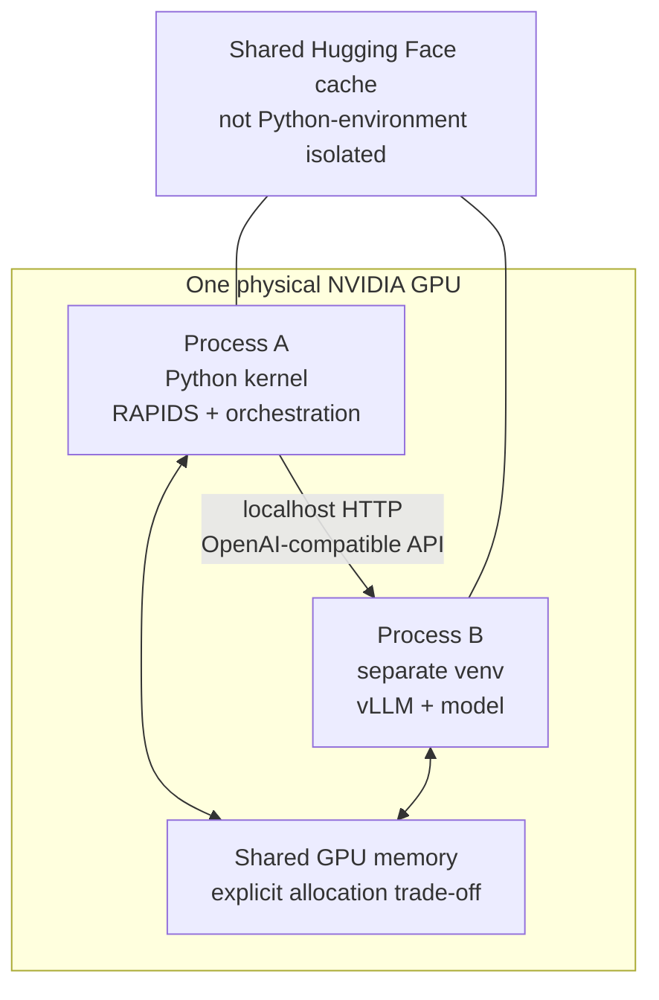
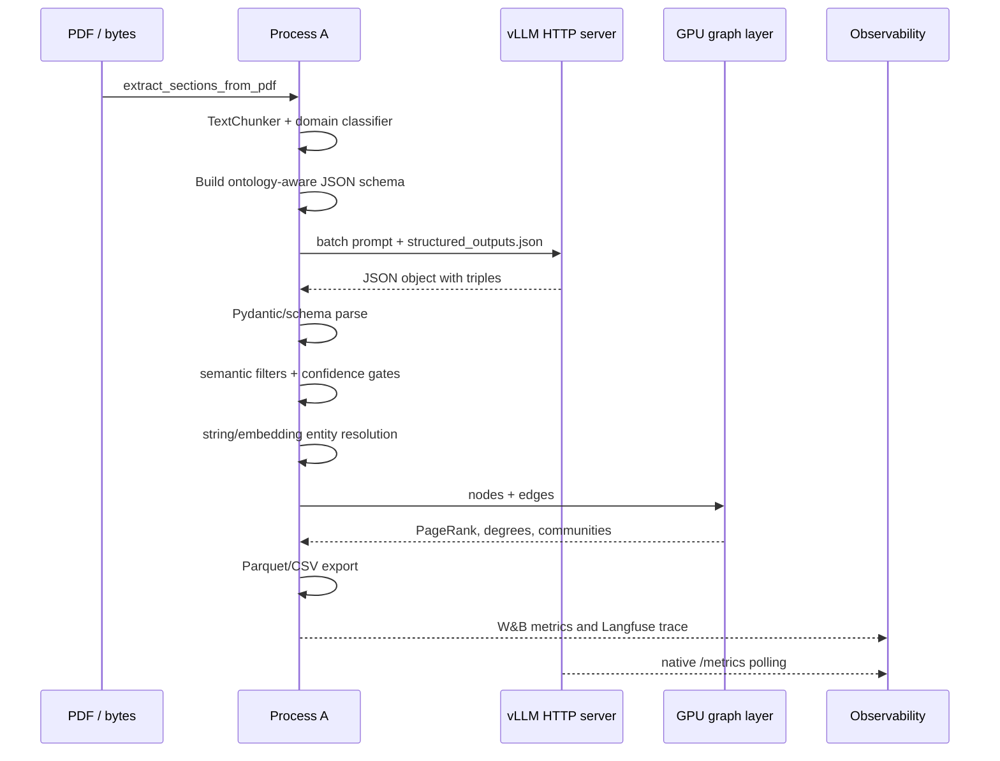
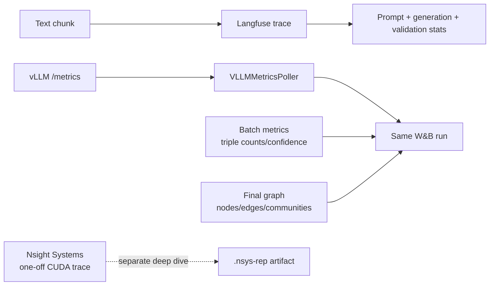

# Architecture and execution model

This document explains the v1 pipeline as a system rather than as a list of notebook cells. The notebook remains the source of truth; `kg_pipeline.py` is the exact source emitted by its `%%writefile` cell.

## 1. Two processes, one GPU

Python-environment isolation is the important boundary. Process A and Process B do not share `site-packages`, so each can resolve the versions it needs. They still share the physical GPU, so `vllm_gpu_memory_utilization` must leave headroom for cuDF, cuGraph, cuML, and temporary tensors. They also see the same user cache, so model weights downloaded by the main environment are visible to the vLLM subprocess.

## 2. End-to-end data path

## 3. Component responsibilities

| Stage | Main symbols | Responsibility | Failure it contains |
|---|---|---|---|
| Intake | `extract_sections_from_pdf` | Convert PDF bytes into usable text/sections | Empty or malformed PDF input |
| Chunking | `TextChunker` | Bound prompt size and preserve overlap | Context overflow and boundary loss |
| Classification | `DomainClassifier` | Pick domain labels and ontology profile | Generic prompt for specialized text |
| Constrained generation | `VLLMTripleExtractor` | Ask vLLM for JSON-schema-constrained triples | Free-form hallucinated output |
| Parsing | `parse_json_triples` | Decode and normalize model response | Markdown fences, wrong wrapper, malformed JSON |
| Validation | `sitl_filter` | Enforce type/predicate and semantic rules | Invalid graph facts |
| Resolution | `resolve_entities_in_edges`, ANN resolvers | Merge aliases and recover likely links | Fragmented graph and duplicate nodes |
| Graph analytics | `GPUGraphAnalyzer` | Compute graph statistics and communities | Slow CPU-only analysis at scale |
| Storage | `export_to_parquet` | Persist nodes, edges, metrics | Non-auditable ephemeral output |
| Observability | `LangfuseTracer`, `VLLMMetricsPoller`, W&B | Connect quality and runtime signals | Tuning without evidence |

## 4. Why JSON Schema instead of regex

The supplied notebook records a real failure mode: a complex regex grammar timed out inside the structured-output compiler. v1 therefore builds a JSON Schema with enums for entity types and predicates, bounded strings, a bounded triple array, required fields, and `additionalProperties: false`. The standalone smoke test intentionally sends the same prompt once without a schema and once with the schema so a server can be checked for both generation and actual constraint enforcement.

## 5. Graph semantics

The graph is directed. Each accepted edge has at least:

- `source` and `target` entity identity;
- a normalized relationship/predicate;
- source and target entity types;
- weight or confidence-related metadata where available;
- enough provenance to distinguish extracted, resolved, and proposed edges.

The graph layer computes degree, PageRank, and Leiden communities. Export is designed for downstream inspection in Polars/Parquet, Gephi, or Cosmograph rather than locking the project into one UI.

## 6. Observability design

This is intentionally not a Prometheus/Grafana dependency chain. vLLM’s native metrics are polled and forwarded to W&B, while Langfuse holds request-level LLM traces and generations. Nsight is optional and one-off: it is useful for kernel-level investigation but should not be required for every run.

## 7. Memory and throughput trade-offs

The v1 defaults are coherent for the supplied T4 envelope, not universal recommendations:

| Setting | v1 default | Why it exists |
|---|---:|---|
| `vllm_gpu_memory_utilization` | `0.45` | Leave GPU memory for RAPIDS allocations |
| `batch_size` | `8` | Bound concurrent extraction pressure |
| `max_input_tokens` | `900` | Fit chunks below the model context budget |
| `max_output_tokens` | `768` | Bound generation and worst-case schema output |
| `max_triples_per_chunk` | `20` | Bound structured output size |
| `vllm_speculative_method` | `ngram` | Avoid loading a second draft model |
| `enforce_eager` during smoke test | `True` | Fast correctness-first startup |

Throughput mode disables eager execution so vLLM can compile/capture CUDA graphs, but that startup is intentionally a separate notebook step. Correctness and throughput are different experiments.

## 8. Extension points

The optional active-learning section turns validator outcomes into DPO preference data, and the DSPy section searches over extraction prompt phrasing. Those features call the vLLM endpoint directly and are downstream of the core pipeline; they should be treated as experiments with their own evaluation set, not as prerequisites for graph extraction.
