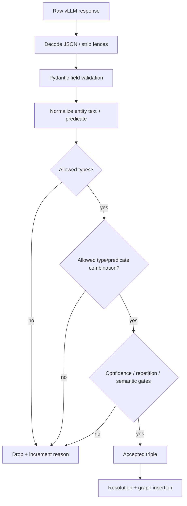

# Data contract and validation gates

The extraction contract is designed to make model output inspectable and rejectable. The model is not allowed to invent arbitrary field names, entity types, predicates, or unbounded text.

## JSON shape

```json
{
  "type": "object",
  "properties": {
    "triples": {
      "type": "array",
      "maxItems": 20,
      "items": {
        "type": "object",
        "properties": {
          "subject": {"type": "string", "minLength": 1, "maxLength": 80},
          "subject_type": {"type": "string", "enum": ["PERSON", "ORGANIZATION", "CONCEPT", "PRODUCT", "LOCATION", "EVENT", "LAW", "METRIC", "PROCESS", "DOCUMENT", "TECHNOLOGY", "PROVISION"]},
          "predicate": {"type": "string", "enum": ["is_a", "instance_of", "part_of", "contains", "includes", "develops", "authors", "issues", "regulates", "manages", "governs", "performs", "enables", "causes", "requires", "produces", "applies_to", "affiliated_with", "located_in", "related_to", "influences", "depends_on"]},
          "target": {"type": "string", "minLength": 1, "maxLength": 80},
          "target_type": {"type": "string", "enum": ["PERSON", "ORGANIZATION", "CONCEPT", "PRODUCT", "LOCATION", "EVENT", "LAW", "METRIC", "PROCESS", "DOCUMENT", "TECHNOLOGY", "PROVISION"]}
        },
        "required": ["subject", "subject_type", "predicate", "target", "target_type"],
        "additionalProperties": false
      }
    }
  },
  "required": ["triples"],
  "additionalProperties": false
}
```

The canonical constants live in `kg_pipeline.py` and are reused to construct the schema, Pydantic literals, prompts, and filters. The standalone server test duplicates the small contract on purpose so it can run without importing RAPIDS or the main pipeline.

## Validation sequence



The important operational property is that invalid outputs are measurable. A run should expose how many generations parsed, how many triples were dropped at each gate, and what was finally inserted into the graph.

## Resolution semantics

Resolution happens after basic validation. The pipeline can use:

- string similarity for cheap local matching;
- sentence-transformer embeddings for semantic similarity;
- cuML-backed ANN indexing when available;
- a missing-edge proposal path with thresholds and a maximum proposal budget.

Resolution is not proof of truth. It is a graph-completion heuristic. Consumers should preserve whether an edge was directly extracted, merged as an alias, or proposed by ANN connectivity enhancement.
